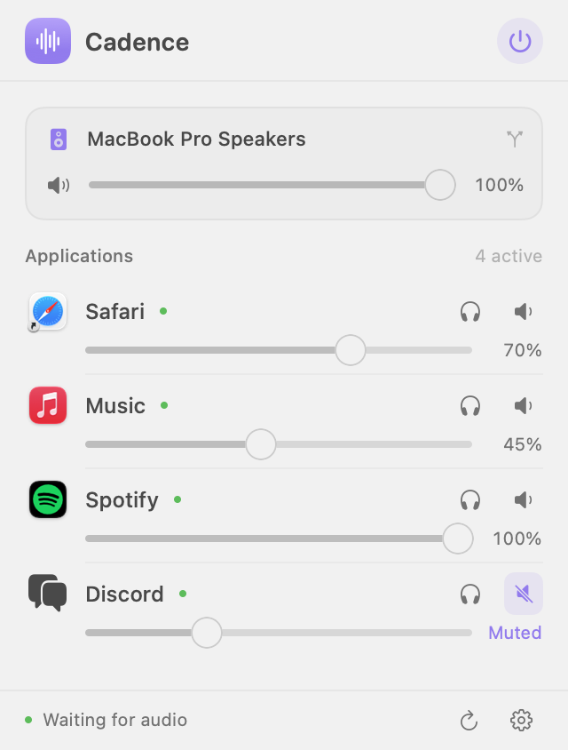

# Cadence

**A little more harmony.** A lightweight, native application volume mixer for macOS.

Cadence lives in your menu bar and gives each audio application its own volume, mute, and solo controls. Built with SwiftUI, AppKit, and Core Audio process taps, with no virtual driver or third-party dependencies.

<picture>
  <source media="(prefers-color-scheme: dark)" srcset="docs/images/cadence-dark.png">
  
</picture>

*Native interface shown with sample application data. Appearance follows your Mac.*

## Start using it

Requires **macOS 14.2 or later**. The local build supports your Mac's architecture.

1. Open **Cadence.app** in `~/Applications`.
2. Click **Enable audio control**. Allow Cadence to capture system audio when macOS prompts. This permission lets Cadence adjust the live sound; it does not save recordings.
3. Play audio in an application. It appears automatically within two seconds.
4. Adjust its slider, click its speaker to mute, or click its headphones to hear only that app.

Closing the window leaves Cadence in the menu bar. Click its sliders icon to open the compact mixer; right-click for the window, pause, and quit actions. Pausing or quitting releases the taps and restores the applications' original playback. Remembered levels apply when you enable Cadence again.

The mixer opens beneath its menu-bar icon by default. Its 320-point width and content-sized height keep it out of the way: one active app fits in 263 points of height, four fit in 422, and longer lists scroll. Settings stays inside the same compact panel. The optional window also fits its content automatically.

Click outside the mixer or switch to another app to collapse it. This applies to both the menu-bar panel and the optional window, including Settings. Audio control keeps running at your chosen levels; click Cadence's menu-bar icon to reopen it. No Accessibility or Input Monitoring permission is needed for dismissal.

The mixer follows your system output, including headphones and Bluetooth speakers. Its master slider attenuates controlled applications; your keyboard volume keys continue to control the hardware volume. Per-app levels and mute settings are remembered by application bundle identifier. Global mute and solo reset when you relaunch.

## Build and install

Install Xcode or the matching Command Line Tools, then run:

```sh
bash scripts/build.sh
bash scripts/install.sh
```

The build creates `dist/Cadence.app` and `dist/Cadence-macOS.zip`. Installation defaults to `~/Applications` and requires no administrator access. Set `CADENCE_INSTALL_DIR` to choose another destination. Quit an existing copy before updating. The local app uses an ad-hoc signature; it is not Developer ID signed or notarized for general distribution.

To work on the app:

```sh
swift build
swift test
CONFIGURATION=debug bash scripts/build.sh
```

Open `Package.swift` in Xcode for source navigation and debugging. Run the packaged app when testing permissions so macOS sees the correct application identity.

## Privacy and permissions

All audio processing happens in memory on your Mac. There is no network client, analytics, account, microphone capture, or recording feature. Only gain settings are saved, in the app's macOS preferences.

If sliders have no effect, open **Settings** in Cadence → **Open Privacy Settings**. Enable Cadence under **Privacy & Security → Screen & System Audio Recording** (the exact label varies by macOS version), then click **Retry audio**. macOS can return silent audio when permission is denied, so an active audio session alone is not proof that audio access has been granted.

## Compatibility

- Browser and Electron helper processes are grouped under their outer application. Browser tabs share one application volume.
- Active audio sessions can remain open while silent. The dot and “Playing” label indicate an actual signal; “Audio session active” indicates that an application has opened its output.
- The engine targets the first output stream of the system's default device and requires 32-bit floating-point PCM. Standard built-in and Bluetooth stereo outputs are the primary target. Exclusive/hog-mode devices, protected media, applications explicitly using another output, and unusual multistream or surround interfaces may not be controllable.
- Output-device changes and sleep/wake rebuild private routes. There may be a brief transition during rerouting.
- Launch at login is optional and uses Apple's ServiceManagement API. macOS may require approval in Login Items.

## Verification and diagnostics

```sh
~/Applications/Cadence.app/Contents/MacOS/Cadence --diagnose
```

This prints local output and process metadata; review it before sharing. A manual route check is available while a known process is producing sound:

```sh
~/Applications/Cadence.app/Contents/MacOS/Cadence --verify-pid <PID>
```

It checks 25%, mute, 75%, and 100% gain over about five seconds, compares input and rendered signal peaks, then releases the route. Exit code 0 means every measured ratio matched. Quit the regular mixer first to avoid overlapping taps. Synthetic tests independently verify output sample levels, mute, ramping, and buffer handling. To run with an automatically generated quiet test signal, use `python3 scripts/verify-audio.py`.

Design fixtures can be rendered without tapping audio:

```sh
dist/Cadence.app/Contents/MacOS/Cadence --snapshot /tmp/cadence-light.png
dist/Cadence.app/Contents/MacOS/Cadence --snapshot /tmp/cadence-dark.png --dark
```

These images use sample application data, not a capture of the user's current audio sessions.

See [architecture](docs/ARCHITECTURE.md) and [verification notes](docs/VERIFICATION.md). MIT licensed.
